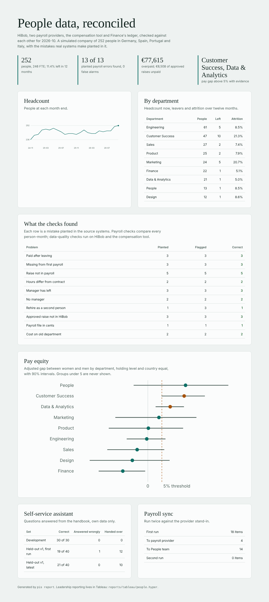

# people-intelligence-suite

**One view of People data that leadership can trust, built from HiBob, payroll, the compensation tool and
Finance's ledger; the checks that keep those systems honest with each other; an employee self-service
assistant that never shares anyone else's data; and the n8n workflows that put it to work. GDPR is built in,
not added later.**

It runs on a simulated company of about 250 people in Germany, Spain, Portugal and Italy. The data comes
in the shapes the real systems use, with the mistakes People teams actually meet planted in it. Because
the mistakes are known, every number below is a measured result, not a demo
([ADR 0001](docs/adr/0001-a-simulated-company-with-planted-mistakes.md)).



## Results

From `pis evaluate` ([reports/REPORT.md](reports/REPORT.md), [dashboard](reports/dashboard.html)).

| Planted problem | Planted | Flagged | Correct |
|---|---:|---:|---:|
| Paid after leaving | 3 | 3 | 3 |
| Missing from the first payroll | 3 | 3 | 3 |
| Raise in HiBob, not in payroll | 5 | 5 | 5 |
| Part-time in HiBob, full time in payroll | 2 | 2 | 2 |
| Reports to a manager who left | 3 | 3 | 3 |
| No manager | 2 | 2 | 2 |
| Approved raise never entered in HiBob | 3 | 3 | 3 |
| A payroll file sent in cents | 1 | 1 | 1 |
| Cost booked to an employee's old department | 2 | 2 | 2 |
| A rehire created as a second person | 1 | 3 | 1 |

- **5,944 person-months reconciled** between HiBob and two payroll providers: 13 people with exceptions,
  all of them planted, no false alarms. Money at stake: €17,425 paid to people after they left, €60,190
  paid for hours that are not in the contract, €6,508 of approved raises never paid.
- **The file in cents was quarantined whole**, and its 31 people are reported as "source quarantined",
  not as 31 unpaid employees.
- **All 37 ledger breaks were explained.** Payroll cost and the GL disagree by department in 37
  month-entity pairs. Each pair cancels out, and each is traced to the one transfer Finance still books
  to the old cost centre.
- **Pay equity.** The adjusted gap between women and men is 4.0% overall, holding level, country and
  department equal. The planted gap in Customer Success is found (12.9%, 90% interval 4.9% to 20.3%).
  Data & Analytics also shows a gap with evidence; with nine departments tested, one false alarm at 90% is
  expected, so it is a case for a joint pay assessment, not a conclusion. People crosses the EU Pay
  Transparency Directive's 5% line on 13 people, with an interval through zero.
- **Payroll sync, run twice:** the first run produced 18 items. Four were change requests for the payroll
  team to approve; 14 were judgements for the People team (overpayments, duplicates, managers). The
  second run sent nothing. A deliberately retried call created no second request.

**The self-service assistant:**

| Questions | Correct | Answered when it should not | Handed over when it could answer |
|---|---:|---:|---:|
| 30 development questions (written by me, tuned on) | 30 | 0 | 0 |
| 40 held-out questions, first run (written blind, recorded on commit 6c3a851) | 19 | 1 | 12 |
| The same 40, latest (not studied) | 21 | 0 | 10 |

The held-out set is the honest number. It was written by an agent that saw only the handbook and
[the writing guide](eval/WRITING_QUESTIONS.md). Its first run is pinned by
[first_run.sha256](reports/heldout/v1/first_run.sha256). The assistant fails in the safe direction: it
hands a person a question it could have answered far more often than it answers one it should not. On the
first run it answered one question it should not have; since then, through fixes made only from
development failures, none. Its coverage is the work still to do.

## What it does

```
 HiBob API ──┐   contracts     dbt warehouse (DuckDB; PostgreSQL target)        ┌──▶ Tableau extract (.hyper)
 payroll ────┼─▶ quarantine ─▶ employee_month · payroll recon · GL recon    ───┼──▶ dashboard, REPORT.md
 comp tool ──┤   with reasons  headcount · comp position · data quality         ├──▶ pay equity (aggregates only)
 Finance GL ─┘                                                                   └──▶ API ◀── n8n workflows
                                                                                     /ask        self-service chat
                                                                                     /sync/plan  payroll sync
```

- **HiBob connector** ([connectors/hibob.py](src/pis/connectors/hibob.py)). It reads as HiBob recommends for
  a whole company: IDs first, then fields in batches of 100, with leavers included. Effective-dated tables
  come through the paginated bulk endpoints. 429s are retried after `Retry-After`. A field the service
  user cannot read is *reported*, because HiBob leaves it out silently instead of failing.
- **Contracts at the door** ([ingest.py](src/pis/ingest.py)). Every row passes range, duplicate and
  ordering checks. Bad rows go to quarantine with a reason; a file that is mostly wrong is quarantined
  whole. The two vendors' department spellings are mapped through `config/policy.yaml`.
- **The warehouse** ([warehouse/](warehouse)). A dbt project with tests. `employee_month` holds what HiBob
  says each person should cost each month, prorated for the days employed. `fct_payroll_recon` gives
  every person-month exactly one status. `fct_gl_recon`, `fct_headcount_monthly`, `fct_comp_position`
  (against the published bands) and `dq_issues` sit alongside.
- **Pay equity** ([analytics.py](src/pis/analytics.py)). It reads gender through a separate HiBob service
  user that may read the personal category and nothing about pay. Gender is joined in memory, reported
  only in aggregate, and groups under five are suppressed.
- **Tableau** ([tableau.py](src/pis/tableau.py)). It writes one `.hyper` extract with six tables and reads
  it back to prove the row counts. Pseudonymised: keyed HMAC, no names, emails or HiBob IDs. The data
  model is in [docs/tableau-data-model.md](docs/tableau-data-model.md).
- **The assistant** ([assistant/core.py](src/pis/assistant/core.py),
  [ADR 0002](docs/adr/0002-rules-decide-what-the-assistant-answers.md)):
  - it answers from the handbook section for the asker's country and cites it;
  - it reads the asker's own vacation balance and manager, and nobody else's;
  - it refuses questions about other people's pay or balance;
  - it hands harassment, pay disputes, action requests and uncovered questions to a person;
  - every read of personal data goes into a hash-chained audit log.
- **n8n workflows** ([n8n/workflows](n8n/workflows), built from [n8n_build.py](src/pis/n8n_build.py)):
  - *People self-service*: a chat webhook with a secret calls `/ask` and replies; handoffs open a People
    ticket.
  - *Payroll sync*: on weekday mornings it reads `/sync/plan` and sends mechanical fixes to the payroll
    provider with an `Idempotency-Key`. Judgements go to the People team, and every item is acknowledged
    so nothing is sent twice. Credentials are named, never stored in the files.
- **Playbook** ([docs/playbook](docs/playbook/README.md)) for the People team: the monthly routine, how to
  add a handbook answer, how to change a rule, how to extend the workflows.

## Limits

- The company is simulated. The results show the method works on data shaped like HiBob's and two payroll
  providers', not any real company's numbers. HiBob is a local stand-in built from its public API
  documentation, not a live tenant.
- I have not authored the Tableau workbook here (Tableau Desktop does not run in this environment). The
  extract, its data model and suggested views are ready for one.
- The n8n workflows are checked for structure, routing, idempotency headers and secrets. The same flow is
  run end to end against the API and a provider stand-in. They have not been executed inside n8n in this
  repository: the build machine ran out of disk for an n8n install.
- The duplicate check flags 3 records for 1 real duplicate. Without birth dates (which the People service
  user cannot read, on purpose) a shared name is all it has, so a person reviews them.
- The assistant's coverage on blind questions is about half.

## Run it

```bash
pip install -e ".[dev]"
pytest -q          # 44 tests, under 30 seconds
pis simulate       # (re)write the simulated company into data/sources and data/truth
pis pipeline       # HiBob stand-in and files -> contracts -> dbt build
pis evaluate       # score against the truth -> reports/results.json
pis report         # REPORT.md, dashboard.html and reports/tableau/people.hyper
pis n8n            # write the n8n workflows
pis serve          # the API the workflows call (PIS_API_TOKEN)
```

Against real systems: set `HIBOB_BASE_URL`, `HIBOB_SERVICE_USER` and `HIBOB_TOKEN` (plus
`HIBOB_PAY_EQUITY_USER` and `HIBOB_PAY_EQUITY_TOKEN`), put the payroll and ledger exports in
`data/sources/`, and set `PIS_PSEUDONYM_KEY`.

See [AGENTS.md](AGENTS.md) for the rules that keep the evaluation honest.
